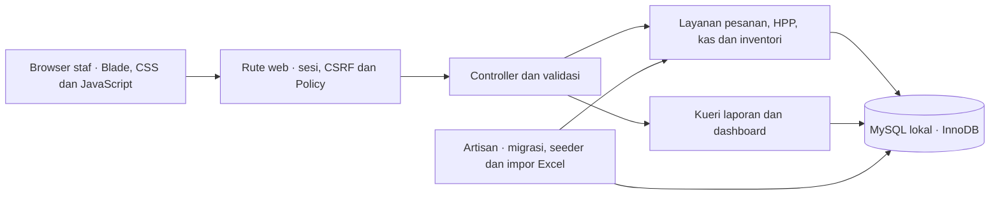

# Rancangan Implementasi SIM Furniture Nadeen

Rilis pertama adalah aplikasi web internal untuk mencatat pesanan furniture, menghitung harga pokok penjualan (HPP), mengelola pembayaran dan kas, memantau persediaan, serta menyajikan laporan untuk pemilik. Aplikasi dan MySQL berjalan pada satu komputer Windows. Untuk pengembangan, akses awal melalui browser pada komputer tersebut. Jika beberapa staf perlu membuka aplikasi dari perangkat lain, web server melayani jaringan kantor melalui HTTPS dan MySQL tetap mendengarkan di loopback.

Acuan bisnisnya adalah Bab 1 sampai Bab 7, Tabel 1 sampai 5, dan Gambar 1 sampai 6 dalam [Laporan Tahap Perancangan UMKM Furniture Nadeen](../Laporan%20Tahap%20Perancangan%20-%20UMKM%20Furniture%20Nadeen.docx). Status pengerjaan dicatat di [README proyek](../README.md).

## Cakupan dan keterlacakan

| Masalah dalam laporan | Hasil yang harus tersedia | Use case dan DFD |
| --- | --- | --- |
| M1. Buku kas tanpa tanggal atau kategori konsisten | Buku kas bertanggal otomatis, kategori dan keterangan wajib, saldo berjalan, serta pemisahan arus rutin dan nonrutin | UC-03, UC-04 · 3.0, 5.0 |
| M2. Pesanan dan pembayaran terpisah | ID pesanan otomatis, pelanggan dari master baku, nota, riwayat DP hingga lunas, dan tautan pembayaran ke kas | UC-01, UC-02, UC-03 · 1.0, 2.0, 3.0 |
| M3. HPP dan laba keliru | Estimasi bahan, upah, dan overhead, serta HPP aktual pesanan barang stok dan pesanan khusus | UC-04, UC-06 · 2.0, 5.0 |
| M4. Inventori dan umur bahan tidak tercatat | Riwayat stok bahan dan barang jadi, kondisi, belanja pemasok, stok minimum, dan umur lot | UC-05, UC-07 · 4.0, 5.0 |
| M5. Kode barang dan status bercampur | SKU unik per varian dan status bayar, produksi, serta pengiriman yang berdiri sendiri | UC-01, UC-02, UC-08 · 1.0, 2.0, 4.0 |
| M6. Ketergantungan pelanggan dan pesanan tanpa estimasi | Estimasi dan simulasi markup sebelum konfirmasi serta dashboard persentase kontribusi pelanggan | UC-05, UC-06 · 2.0, 5.0 |
| Akses internal | Login per staf dan pembatasan menu serta operasi berdasarkan peran | UC-09 |

Pelanggan dan pemasok berinteraksi dengan staf. Staf memasukkan data dan memberikan nota cetak atau PDF kepada pelanggan. Pembayaran dicatat dari penerimaan yang sudah terjadi. Rilis pertama menggunakan satu lokasi stok, satu buku kas gabungan, dan mata uang rupiah. Portal pelanggan, payment gateway, akuntansi buku besar, dan multi-gudang berada di luar cakupan rilis ini.

### Hak akses

| Operasi | Pemilik atau admin | Produksi dan gudang |
| --- | --- | --- |
| Akun internal, pelanggan, supplier, produk, dan standar HPP | Kelola dan nonaktifkan | Baca kode, nama produk, dan supplier yang diperlukan saat belanja |
| Pesanan | Buat draf, konfirmasi harga, cetak nota, tinjau HPP aktual, dan batalkan sesuai aturan | Lihat pesanan terkonfirmasi, spesifikasi kerja, kuantitas, dan data pengiriman yang diperlukan |
| Produksi, pengiriman, dan inventori | Pantau, kelola bila diperlukan, dan setujui valuasi atau koreksi | Catat belanja, barang masuk, pemakaian bahan, kondisi lot, dan pembaruan progres |
| Pembayaran dan kas | Catat pembayaran, transaksi manual, koreksi, serta cetak bukti bayar | Catat nominal belanja pada transaksi pemasok yang sedang diinput. Kas keluar dibuat oleh sistem |
| Pelaporan | Arus kas, laba rugi, laba per pesanan, inventori, dan dashboard pemilik | Laporan inventori tanpa kolom harga, HPP, atau laba |

Laravel Policy memeriksa otorisasi pada setiap aksi, termasuk permintaan estimasi, halaman cetak, dan data laporan. Tampilan produksi memilih kolom yang diizinkan di server. Akun staf dibuat oleh pemilik atau admin. Admin pertama dibuat melalui perintah Artisan interaktif dan kata sandi disimpan dengan mekanisme hashing Laravel. Saat akun dinonaktifkan atau kata sandinya direset, sesi lama dibatalkan.

## Stack dan package

Laravel adalah monolit modular yang merender halaman Blade dan menangani transaksi bisnis dalam proses aplikasi yang sama. Formulir memakai HTML, CSS kustom, dan JavaScript kecil untuk rincian pesanan dinamis dan pratinjau estimasi. Perhitungan resmi tetap dilakukan oleh server. Grafik kontribusi cukup dengan batang HTML/CSS dan tabel data. Nota dan bukti bayar memakai halaman Blade dengan CSS cetak agar pengguna bisa mencetak ke kertas atau menyimpan sebagai PDF dari browser. [Laravel Vite](https://laravel.com/docs/13.x/vite) · [CSS untuk tampilan cetak](https://developer.mozilla.org/en-US/docs/Web/CSS/Guides/Media_queries/Printing)

| Alat atau package | Target | Tahap | Pemakaian |
| --- | --- | --- | --- |
| PHP dan Composer | PHP 8.4 64-bit, Composer 2 | T01 | Runtime aplikasi dan resolusi dependensi PHP |
| MySQL Community Server dan CLI | MySQL 8.4 LTS, InnoDB, `utf8mb4` | T01 | Penyimpanan lokal, termasuk migrasi, backup, dan restore melalui `mysql` dan `mysqldump` |
| Node.js dan npm | Node.js 24 LTS beserta npm | T01 | Build aset dan pengelolaan lockfile npm |
| `laravel/laravel` | Scaffold 13.x | T01 | Titik awal aplikasi |
| `laravel/framework` | 13.x · Composer runtime | T01 | Blade, sesi, hashing, Policy, CSRF, validasi, Eloquent, migrasi, dan transaksi |
| `ext-pdo_mysql` | Ekstensi PHP · Composer platform | T01 | Koneksi PHP ke MySQL |
| `ext-bcmath` | Ekstensi PHP · Composer platform | T01 | Operasi desimal untuk HPP, persediaan, dan kas |
| `vite` | 8.x · npm dev | T01 | Build CSS dan JavaScript |
| `laravel-vite-plugin` | 3.x yang kompatibel dengan Vite 8 · npm dev | T01 | Integrasi aset dan pemuatan ulang Blade saat pengembangan |
| `laravel/pint` | 1.x · Composer dev | T01 | Pemeriksaan format PHP |
| `phpunit/phpunit` | 12.x · Composer dev | T01 | Uji unit, HTTP, dan integrasi MySQL |
| `phpoffice/phpspreadsheet` | Rilis stabil yang lolos resolusi Composer untuk PHP 8.4 · Composer runtime | T08 | Pembaca berkas Excel untuk perintah impor lokal |
| Apache HTTP Server | 2.4 · web server Windows untuk pilot, dengan PHP 8.4 Thread Safe | T09 | Menjalankan aplikasi sebagai layanan dan menyajikan HTTPS pada jaringan kantor |

Gunakan dependensi di atas sebagai kebutuhan langsung. Catat paket bawaan scaffold yang dipertahankan beserta fungsinya di pelacak. Saat inisialisasi, simpan `composer.lock` dan `package-lock.json`, lalu gunakan `composer install` dan `npm ci` pada instalasi berikutnya. Catat versi yang benar-benar terpasang setelah pemeriksaan berhasil. Jalankan `composer check-platform-reqs` untuk ekstensi inti Laravel dan ekstensi tambahan pembaca Excel, termasuk `gd` dan `zip` sesuai versi package yang terpasang. [Laravel 13](https://laravel.com/docs/13.x/releases) · [Manifest PHP scaffold](https://github.com/laravel/laravel/blob/13.x/composer.json) · [Manifest npm scaffold](https://github.com/laravel/laravel/blob/13.x/package.json) · [Node.js LTS](https://nodejs.org/en/about/previous-releases) · [Vite](https://vite.dev/guide/) · [PhpSpreadsheet](https://phpspreadsheet.readthedocs.io/en/latest/) · [BCMath](https://www.php.net/manual/en/bc.installation.php)

### Arsitektur kode

- `routes/web.php`, `app/Http`, dan `app/Policies` untuk rute, validasi, dan akses berdasarkan peran.
- `app/Models` untuk relasi Eloquent. `app/Services` untuk proses yang menyimpan beberapa rekaman sekaligus dan aturan HPP. `app/Queries` untuk agregasi laporan.
- `resources/views`, `resources/css`, dan `resources/js` untuk tampilan dan interaksi. `database/migrations` serta `database/seeders` untuk struktur dan data referensi. `tests/Unit` dan `tests/Feature` untuk uji.
- Rute baca utama memakai `GET` untuk `/pesanan`, `/buku-kas`, `/inventori`, `/pembelian-bahan`, `/master`, `/laporan`, dan `/dashboard`. Rute tulis konfirmasi pesanan, penerimaan pembayaran, pembelian, dan perubahan status memakai `POST` atau `PATCH` sesuai operasi. Halaman cetak membaca data yang sudah disimpan. Pratinjau HPP memakai endpoint perhitungan internal dengan validasi dan ambang frekuensi permintaan yang wajar.

### MySQL lokal dan konfigurasi

- Siapkan `sim_nadeen` untuk pengembangan dan `sim_nadeen_test` untuk pengujian, masing-masing dengan kredensial sendiri. Gunakan akun per lingkungan pada `127.0.0.1:3306`. Pada operasional, berikan hak DML kepada akun aplikasi dan gunakan akun migrasi terpisah untuk DDL.
- Isi `DB_CONNECTION=mysql`, `DB_HOST=127.0.0.1`, `DB_PORT=3306`, `DB_DATABASE`, `DB_USERNAME`, dan `DB_PASSWORD` melalui `.env`. Simpan nama variabel dan nilai contoh aman di `.env.example`. Hasilkan `APP_KEY` per lingkungan. Sesi dan cache menggunakan tabel Laravel. Antrean menggunakan mode sinkron.
- Gunakan tanggal bisnis `DATE` dalam zona Asia/Jakarta. Simpan waktu kejadian `DATETIME` dalam UTC dan tampilkan dalam WIB. Tanggal efektif transaksi baru mengikuti hari pencatatan WIB. Impor historis menyertakan tanggal efektif yang telah diverifikasi dan waktu impor yang tercatat sendiri.
- Gunakan kunci asing dengan pembatasan hapus untuk data historis, mode SQL ketat, serta indeks untuk rute pencarian dan agregasi utama. Uji integrasi memakai MySQL agar perilaku tipe desimal, indeks, dan penguncian sesuai lingkungan operasional. [Database Laravel](https://laravel.com/docs/13.x/database) · [MySQL InnoDB](https://dev.mysql.com/doc/refman/8.4/en/innodb-transaction-model.html) · [Aritmetika presisi MySQL](https://dev.mysql.com/doc/refman/8.4/en/precision-math.html)

## Model data

Sebelas tabel domain dari laporan dipertahankan. Pada implementasi, gunakan `BIGINT UNSIGNED` sebagai PK internal dan kode bisnis unik sebagai identitas yang ditampilkan. Ini menyelaraskan perbedaan antara Gambar 4, yang memakai kode produk sebagai PK, dan Tabel 4, yang memakai ID produk. Untuk kuantitas bahan gunakan `DECIMAL(14,3)` agar meter kain dan satuan pecahan lain dapat dicatat. Kuantitas barang jadi berupa bilangan bulat. Nominal yang diposting memakai `DECIMAL(18,2)`, persentase `DECIMAL(7,3)`, dan kalkulasi dilakukan sebagai desimal dengan pembulatan half-up ke dua digit saat nilai dibukukan.

| Tabel sumber | Kolom dan relasi utama |
| --- | --- |
| `pengguna_sistem` | Username unik, nama, hash kata sandi, peran, status aktif |
| `pelanggan` | Nama baku, kontak, alamat, wilayah opsional, status aktif. Nama dapat sama untuk orang berbeda |
| `supplier` | Nama, kontak, alamat, jenis bahan opsional, status aktif |
| `produk` | SKU unik per varian, nama, kategori, varian, harga standar, stok minimum, status aktif |
| `komponen_hpp` | FK produk, versi atau tanggal berlaku, estimasi bahan, upah, overhead, dan markup acuan. Pilih versi aktif terakhir saat membuat estimasi |
| `bahan_baku` | Kode bahan unik, nama, kategori, satuan dasar, stok minimum, status aktif |
| `pesanan` | Kode unik, FK pelanggan, tanggal bisnis, status dokumen, tiga status operasional, klasifikasi penjualan, tanggal konfirmasi, tanggal selesai kirim |
| `detail_pesanan` | FK pesanan dan produk, snapshot SKU/nama, sumber pemenuhan, kuantitas, harga satuan disepakati, status kesiapan, snapshot estimasi bahan/upah/overhead/markup, rincian HPP aktual dan waktu pengesahan |
| `pembelian_bahan` | FK supplier, bahan, dan pesanan opsional, referensi kuitansi, kuantitas dalam satuan dasar, tanggal, total, metode bayar, pembuat, FK pembelian asal untuk koreksi |
| `pembayaran` | FK pesanan, tanggal efektif, nominal, metode, jenis DP atau pelunasan, pembuat, FK penerimaan asal untuk pembalik |
| `transaksi_kas` | FK kategori, tanggal efektif, waktu pencatatan, arah, nominal positif, keterangan, pembuat, FK pembayaran atau pembelian opsional, serta FK jurnal asal untuk koreksi transaksi manual |

| Tabel pendukung | Fungsi dan batasan |
| --- | --- |
| `kategori_kas` | Kode unik, nama, arah normal, penanda rutin/nonrutin, kelompok laporan, status aktif. Simpan klasifikasi pada transaksi saat posting agar perubahan master tidak mengubah histori |
| `lot_stok` | Tepat satu FK bahan atau produk, tanggal masuk atau penanda tanggal belum diketahui untuk stok lama, kondisi, kuantitas dan nilai awal serta sisa, waktu pengesahan nilai, FK pembelian asal opsional |
| `mutasi_stok` | FK lot, perubahan kuantitas dan nilai, tipe mutasi, tanggal, alasan, aktor, FK detail pesanan bila terpakai, dan FK ke mutasi asal bila dibalik |
| `riwayat_status_pesanan` | FK pesanan, aktor, dan detail opsional, dimensi status, nilai sebelum dan sesudah, waktu serta alasan |
| `permintaan_tulis` | Token unik per aksi posting, aktor, jenis operasi, hash input, dan referensi hasil. Ditulis dalam transaksi yang sama dengan hasil bisnis |
| `batch_impor` dan `baris_impor` | Identitas dataset dan versi berkas, hash isi, kunci sumber stabil per baris, hasil validasi, serta referensi entri yang sudah diproses |

Tambahkan tabel teknis Laravel untuk sesi, cache, dan catatan migrasi. Total pesanan berasal dari detail, saldo kas dari jurnal, dan stok tersedia dari sisa lot yang diperbarui bersama jurnal mutasi. Indeks utama mencakup pesanan menurut pelanggan/tanggal dan status, pembayaran menurut pesanan/tanggal, kas menurut tanggal efektif/kategori, serta lot menurut bahan atau produk/tanggal masuk. Gunakan `UNIQUE` pada FK pembayaran dan pembelian dalam kas. Satu rekaman kas otomatis memiliki satu sumber. Transaksi manual dapat menyimpan referensi dokumen sebagai keterangan. Validasi nominal, arah kategori, dan relasi eksklusif pada skema jika dapat dinyatakan sebagai constraint dan di layanan untuk aturan antarbaris.

## Aturan operasi

### Pesanan, estimasi, dan pemenuhan stok

1. Admin memilih pelanggan dan beberapa SKU dari master, menentukan kuantitas, memilih sumber **Stok** atau **Pesanan khusus** tiap baris, lalu meninjau harga yang disarankan. Untuk kombinasi dua sumber pada SKU yang sama, buat dua baris. Draf memperoleh kode `ORD-{tahun WIB}-{id}` segera setelah disimpan. ID numerik dipad hingga enam digit dan dipakai apa adanya ketika lebih panjang.
2. HPP estimasi per unit = bahan + upah tukang + overhead. Harga saran = HPP estimasi × (1 + markup / 100). Estimasi laba per baris = (harga satuan disepakati × jumlah) − (HPP estimasi per unit × jumlah). Margin = laba ÷ nilai jual × 100 jika nilai jual positif. Pratinjau boleh dihitung ulang sampai konfirmasi dan snapshot final disimpan saat konfirmasi. Harga jual wajib positif. Data HPP kosong muncul sebagai **HPP belum lengkap** dan menghalangi konfirmasi. Nilai komponen nol boleh dipakai jika sengaja ditetapkan dan alasannya terdokumentasi.
3. Saat konfirmasi, transaksi basis data memeriksa ketersediaan barang stok, mengalokasikan lot layak pakai dari yang masuk paling awal, mengurangi saldo, menyimpan rincian HPP aktual, dan menerbitkan tagihan. Jika unit stok kurang atau nilainya belum disahkan, admin dapat memperbaiki alokasi atau memilih pesanan khusus sebelum konfirmasi. Nota estimasi tersedia dari draf tersimpan. Nota tagihan dan bukti bayar mengambil data dari dokumen terkonfirmasi. Harga dan identitas detail dibekukan setelah konfirmasi.
4. Untuk pesanan khusus, staf gudang mencocokkan kebutuhan dengan stok tersedia sebelum produksi dan mencatat belanja bila bahan kurang. Saat bahan dipakai, sistem memprioritaskan lot layak pakai tertua dan menautkan mutasi ke detail pesanan. HPP bahan aktual berasal dari nilai mutasi pemakaian bersih. Admin meninjau upah dan overhead aktual sebelum mengesahkan biaya. HPP aktual per detail adalah nilai total bahan, upah, dan overhead yang dibebankan pada detail. Pembelian bahan baru menambah persediaan dan mengurangi kas. Pembebanan ke HPP mengikuti pemakaian bahan yang terkait pesanan.
5. Barang jadi masuk dari saldo awal atau hasil produksi untuk stok dengan valuasi yang disahkan admin. Saat barang atau bahan keluar, alokasikan nilai proporsional dengan rumus nilai sisa lot × jumlah keluar ÷ kuantitas sisa sebelum keluar. Bebankan seluruh nilai sisa pada pengeluaran terakhir dari lot. Mutasi pembalik mengembalikan kuantitas dan nilai mutasi asal. Perhitungan berjalan pada baris lot yang dikunci dan dicatat per mutasi. Penjualan dengan biaya historis yang belum terverifikasi ditandai terpisah di laporan.

### Pembelian, pembayaran, dan buku kas

- Pembelian yang sudah dibayar dicatat per baris bahan dari pemasok, dengan referensi kuitansi bersama jika satu kuitansi mencakup beberapa bahan. Satu transaksi basis data membuat pembelian, lot, mutasi masuk, dan satu kas keluar **Bahan Baku**. Nilai stok masuk mengikuti total biaya per baris. Gudang dapat memilih pesanan terkait bila belanja khusus untuk pesanan itu.
- Pembayaran menaut ke pesanan terkonfirmasi. Kasir memasukkan nominal positif hingga sisa tagihan. Server mengklasifikasikan penerimaan di bawah sisa sebagai DP atau cicilan dan penerimaan sebesar sisa sebagai pelunasan. Jumlah penerimaan bersih nol menghasilkan **Menunggu Pembayaran**, kurang dari total menghasilkan **DP**, dan sama dengan total menghasilkan **Lunas**. Pembayaran, kas masuk, dan status bayar disimpan secara atomik.
- Kategori awal adalah **Penjualan**, **Jual Stock Non-Rutin**, **Bahan Baku**, **Komisi**, **Operasional**, **Konsumsi**, **Gaji**, dan **Saldo Awal**. Sumber pemenuhan stok pada detail tidak otomatis menentukan kategori nonrutin. Klasifikasi nonrutin mengikuti kesepakatan pemilik, dan entri kas otomatis memakai referensi sumber yang dapat dibuka oleh admin.
- Kas manual mewajibkan kategori, nominal, dan keterangan. Saldo pada daftar dihitung sebelum filter kategori diterapkan, menggunakan tanggal efektif, waktu catat, lalu PK sebagai urutan stabil. Kas awal periode mengambil saldo sebelum periode. Saldo awal migrasi mengawali buku kas dan dikeluarkan dari arus operasional.
- Untuk koreksi, catat entri pembalik dengan alasan dan tautan ke entri asli. Pembalik mempertahankan kategori sumber dengan arah dan dampak laporan yang berlawanan. Pembalikan pembayaran juga menghitung ulang status bayar. Pembelian hanya boleh dibalik jika lot utuh dan riwayatnya memungkinkan pengembalian penuh. Koreksi pembelian yang sudah terpakai perlu rekonsiliasi admin sebelum posting. Pembatalan pesanan sebelum kirim memerlukan pembayaran sudah dibalik dan gudang memverifikasi barang siap jual yang kembali. Bahan yang sudah digunakan tetap tercatat sebagai pemakaian dan biaya pembatalannya ditinjau admin. Gunakan histori dan entri koreksi untuk mempertahankan jejak sumber.
- Operasi yang memengaruhi beberapa tabel memakai transaksi InnoDB. Kunci pesanan dan baris stok terkait pada urutan yang konsisten, periksa ulang saldo di dalam transaksi, dan ulangi transaksi bila terjadi deadlock yang dapat dicoba ulang. Token aksi dan constraint unik mencegah klik ganda atau retry membuat jurnal dan mutasi tambahan. Batas kuantitas dan saldo tetap berlaku untuk dua pengguna yang bekerja bersamaan.

### Status dan inventori

| Dimensi | Alur rilis pertama |
| --- | --- |
| Dokumen | Draf → Terkonfirmasi, atau Dibatalkan sesuai aturan. Gudang melihat pesanan terkonfirmasi |
| Bayar | Menunggu Pembayaran → DP → Lunas, dengan perubahan berdasarkan penerimaan bersih termasuk pembalikan |
| Produksi | Antri → Dalam Proses → Selesai. Alokasi barang stok menandai baris stok siap tanpa pekerjaan produksi. Pesanan campuran siap ketika semua pekerjaan khusus selesai |
| Pengiriman | Belum Diantar → Dikirim → Selesai. Dikirim memerlukan semua barang siap. Ketentuan minimal pembayaran sebelum kirim mengikuti kebijakan pemilik |

Stok minimum aktif saat saldo fisik tersedia ≤ ambang item. Lot rusak ditampilkan beserta kondisinya, dikeluarkan dari stok tersedia, dan diblokir untuk pemenuhan. Stok yang belum disahkan nilainya ditandai agar gudang dapat membedakan saldo fisik dan stok yang siap dialokasikan. Umur stok dihitung dari lot tersisa tertua dengan tanggal yang diketahui. Lot dengan tanggal belum diketahui ditampilkan dan ditempatkan setelah lot bertanggal dalam urutan pemakaian. Ambang bahan lama awal mengikuti Gambar 5, yaitu **lebih dari 180 hari**. Gudang dapat menyaring kategori, kondisi, dan umur, lalu membuka rincian mutasi dari baris persediaan.

## Laporan pemilik

| Keluaran | Dasar angka dan kontrol |
| --- | --- |
| Arus kas bulanan | Filter bulan/tahun dan kategori. Tampilkan saldo awal, masuk, keluar, arus operasional bersih, arus nonrutin, serta saldo akhir. Sertakan pembalik sesuai periode efektifnya |
| Laba per pesanan | Filter kode pesanan, tanggal pesanan, pelanggan, dan kesiapan HPP. Tampilkan omzet, HPP aktual, laba pesanan, margin jika dapat dihitung, serta sumber pemenuhan. Laba dihitung sebagai nilai jual dikurangi HPP aktual. Tampilkan estimasi di kolom terpisah saat aktual belum tersedia |
| Laba rugi manajemen | Rekomendasi awal memakai tanggal pengiriman selesai untuk omzet, mengurangi HPP aktual, lalu mengurangi pos operasi menurut klasifikasi yang disahkan pemilik. Belanja stok dan upah/overhead yang sudah masuk HPP dikeluarkan dari pengurangan kedua. Tampilkan penyesuaian nonrutin dan cakupan pesanan yang HPP-nya belum lengkap. Tandai hasil sebagai sementara bila ada biaya atau pengelompokan yang belum disahkan |
| Inventori | Filter bahan/barang jadi, kategori, status, dan umur. Nilai inti berupa stok tersedia, stok minimum, umur lot tertua, dan kondisi. Nominal valuasi hanya untuk admin |
| Dashboard konsentrasi dan laba pelanggan | Rekomendasi awal mengikuti basis pesanan lunas pada Gambar 6. Kelompokkan setiap pesanan ke bulan pertama ketika penerimaan bersih per akhir bulan menutup tagihan. Hitung sekali per pesanan dari histori pembayaran dan pembalik. Kontribusi = omzet pelanggan ÷ total omzet pesanan yang masuk basis × 100. Tampilkan jumlah pesanan, omzet pembagi, serta laba pelanggan dari pesanan dengan HPP aktual disertai cakupan HPP. Peringatan awal aktif jika porsi **lebih dari 80%** dan nilai ambang bisa diubah pada filter. Pada periode tanpa omzet, tampilkan keadaan kosong |

## Desain antarmuka dengan Anti Slop

Antarmuka berupa buku kerja bengkel untuk pemilik dan staf gudang, dengan permukaan warna kertas, garis kolom tipis, dan angka rupiah yang mudah dipindai. **ENERGY 1 / RHYTHM 2 / MOTION 1.** Layar transaksi tenang, susunan berubah sesuai jenis tugas, dan gerak terbatas pada umpan balik interaksi. Pemisahan status dan pengelompokan data mengikuti wireframe Bab 5 dan 6.

| Layar | Fokus utama dan susunan |
| --- | --- |
| Masuk | Form username dan kata sandi, dengan judul teks **SIM Nadeen**. Fokus awal pada input pengguna dan ringkasan saat gagal |
| Daftar dan detail pesanan | Pencarian ID atau pelanggan, filter status, lalu tabel dengan kolom bayar, produksi, dan kirim terpisah. Detail menampilkan perjalanan pesanan dan riwayat bayar sesuai peran |
| Pesanan baru dan estimasi | Pemilih pelanggan, baris SKU, sumber, dan jumlah. Ringkasan HPP, harga, dan margin berada di kanan saat cukup lebar dan setelah daftar barang saat sempit. Aksi sesuai keadaan **Simpan draf**, **Konfirmasi pesanan**, atau **Cetak nota** |
| Buku kas | Saldo berjalan menjadi angka utama, diikuti filter dan tabel dengan kolom tanggal, kategori, keterangan, referensi, nominal, serta saldo. Aksi **Catat transaksi** membuka formulir berlabel |
| Inventori dan pembelian | Daftar stok yang perlu ditangani tampil di atas. Tab bahan dan barang jadi dapat dibuka dengan keyboard. Baris menaut ke lot dan mutasi. Pembelian memakai formulir dengan satuan dari master |
| Dashboard dan laporan | Dashboard memprioritaskan kontribusi omzet per pelanggan dengan batang berlabel, periode, dan ambang. Ringkasan kas/laba dan peringatan inventori menaut ke laporan terfilter. Laporan memakai tabel untuk angka yang perlu dibandingkan |
| Master dan akun | Daftar yang bisa dicari, status aktif dan aksi edit yang jelas. Data terpakai dapat dinonaktifkan sambil mempertahankan rujukan dokumen lama |

- **Warna.** Kanvas `#F6F3ED` dan panel putih memisahkan permukaan kerja. Tinta `#24241F` dan teks sekunder `#555750` menjaga keterbacaan tabel. Hijau tua `#285246` dipakai untuk tindakan utama dan indikator fokus. Label peringatan `#75411D` pada `#F9E9D9`, bahaya `#8A3030` pada `#FAE8E5`, dan sukses `#285246` pada `#E6F0EA` menyertakan teks status. Garis batas input `#797A70`. Rasio palet yang dihitung 6,62:1 atau lebih untuk pasangan teks yang ditentukan. Batas input minimal 3,93:1 terhadap permukaan utama. Target aksesibilitas antarmuka adalah WCAG 2.2 AA. [WCAG 2.2](https://www.w3.org/TR/WCAG22/)
- **Tipografi dan komponen.** Gunakan Segoe UI dengan fallback `system-ui` karena tersedia pada lingkungan kerja Windows. Angka tabel memakai `tabular-nums` dengan perataan kanan. Gunakan ritme spasi 4/8/16/24 px dan sudut 6 px pada kontrol. Pakai garis horizontal untuk membantu menelusuri satu transaksi. Gunakan ruang sebelum bagian seperti **Rincian HPP** dan **Pembayaran** untuk memisahkan tugas. Identitas visual muncul dari susunan kolom, kode pesanan, dan format nota yang konsisten.
- **Lebar layar.** Mulai dengan alur satu kolom, label **Menu**, dan daftar transaksi berisi pasangan label–nilai pada layar sempit. Lebar menengah menampilkan tabel inti dan filter yang bisa turun baris. Layar lebar mendapat navigasi samping serta panel ringkasan berdampingan. Tetapkan breakpoint dari ruang yang dibutuhkan konten. Uji pada 320, 375, 768, 1024, dan 1440 px serta ketika zoom 200%. Area sentuh minimal 44 × 44 px dan elemen utama dapat dijangkau tanpa geser halaman horizontal.
- **Interaksi.** Gunakan label terlihat, `lang="id"`, judul halaman dan landmark semantik, urutan tab alami, fokus kontras, serta pesan kesalahan per kolom. Saat menyimpan, tampilkan status dan pertahankan input jika gagal. Saat daftar kosong, beri aksi yang sesuai hak akses. Saat filter tidak cocok, beri **Hapus filter**. Perubahan estimasi diumumkan dengan `aria-live="polite"`. Hormati `prefers-reduced-motion`.
- **Aset dan isi.** Gunakan nama aplikasi sebagai wordmark teks. Data demo diberi label **Data uji**. Label seperti **Stok minimum** hanya tampil jika aturan datanya terpenuhi. Pakai bahasa staf sehari-hari, seperti **Pesanan khusus**, **Catat pembayaran**, dan **Belum ada lot tersedia**.

**Hasil peninjauan rancangan.**

- **Hard Gate · PASS untuk rancangan.** Pasangan warna, fokus, dan batas input sudah dihitung. Rancangan menetapkan label, keadaan kosong, proses simpan, galat, dan reflow.
- **Purpose Gate · PASS untuk rancangan.** Warna, tipografi, garis, dan ruang memiliki fungsi pada layar kerja yang disebutkan.
- **Liveliness · PASS untuk rancangan.** Ketiga dial ditetapkan. Fokus tiap layar dan motif kolom, kode, serta nota tercatat.
- **Craftsmanship · PASS untuk rancangan.** Aksi utama terkait operasi dan keluaran pada laporan sumber. UI nyata diverifikasi pada T09 melalui build, klik setiap kontrol, pemeriksaan konsol, dan uji aksesibilitas.

## Migrasi Excel dan keputusan pemilik

1. Dapatkan buku kas, rekap pesanan/pembayaran, dan master produk/HPP dari pemilik. Simpan sumber di lokasi privat. Pakai perintah Artisan untuk membaca berkas lokal dan menghasilkan ringkasan `dry-run` per sheet. Tinjau tanggal yang kosong, alias nama, duplikat, kategori, status gabungan, kode produk dan varian, harga atau HPP kosong, serta relasi pembayaran ke pesanan.
2. Buat pemetaan yang dapat ditinjau dari identitas lama ke master baku. Baris dengan tanggal, nilai, atau identitas yang belum pasti masuk daftar pengecualian hingga diverifikasi. Pesanan berjalan yang belum punya harga atau HPP masuk sebagai draf setelah identitasnya jelas. Jika pembayaran historis sudah memicu jurnal otomatis saat impor, tautkan baris buku kas sumber ke jurnal tersebut agar nominal tidak tercatat dua kali.
3. Impor dalam urutan master → pesanan dan rincian → lot awal dan histori pembelian yang dipilih → pembayaran dan jurnal kas. Tentukan batas waktu data yang mencakup histori dan cutover. Saldo awal kas dan stok harus mewakili posisi sebelum aktivitas yang ikut diposting lewat impor. Jalankan pada basis data uji, cek ulang jumlah baris dan total kas per jenis, pembayaran per pesanan, saldo awal, serta jumlah dan nilai persediaan. Uji pengulangan dengan kunci sumber stabil dan buat cadangan sebelum impor operasional.

| Keputusan yang memerlukan konfirmasi pemilik | Kapan diperlukan |
| --- | --- |
| Klasifikasi transaksi lama **Jual Stock** sebesar Rp62 juta dan kapan kategori nonrutin berlaku | Sebelum rekonsiliasi kas dan laporan dengan data usaha |
| Standar upah dan overhead per produk, termasuk pos yang sudah dialokasikan ke HPP | Sebelum pengesahan estimasi dan laba operasional |
| SKU dan varian sofa, hasil stok opname, tanggal dan nilai awal lot kain/barang jadi | Sebelum impor saldo persediaan dan pemenuhan pesanan stok |
| Pengguna untuk dua peran, aturan bayar sebelum kirim, tanggal pengakuan omzet manajemen, dan validitas ambang peringatan | Sebelum uji penerimaan dan pemakaian operasional |
| Cakupan periode histori dan saldo awal pada tanggal cutover | Sebelum impor operasional |

Pengembangan dapat memakai fixture sintetis selama keputusan atau berkas sumber masih dikumpulkan. Labeli data uji dan gunakan basis data terpisah.

## Tahapan pengerjaan

| Tahap | Pekerjaan | Syarat selesai |
| --- | --- | --- |
| T00. Rancangan | Baca laporan dan diagram. Tetapkan modul, stack, model data, arah Anti Slop, serta pelacak | Dokumen dan pelacak tersedia. Keputusan pemilik tercatat |
| T01. Fondasi lokal | Periksa PHP, Composer, Node/npm, dan MySQL. Buat scaffold Laravel di folder sementara karena root sudah berisi dokumen. Atur koneksi, manifest, lockfile, Vite, pengujian, dan basis data uji | `composer check-platform-reqs`, `npm run build`, koneksi MySQL, dan migrasi awal berhasil |
| T02. Akun, master, dan layout | Buat login, sesi, Policy dua peran, CRUD master, standar HPP, kategori, dan layout responsif | Kedua peran bisa masuk. Rute terbatas mengembalikan 403. Master bisa dicari dan kode unik tervalidasi |
| T03. Inventori dan lot awal | Implementasikan bahan, barang jadi, lot, kondisi, nilai awal, mutasi, stok minimum, dan umur | Stok pecahan dan barang satuan terekonsiliasi. Saldo tidak negatif. Peringatan muncul pada batas yang tepat |
| T04. Pesanan dan estimasi | Buat editor multi-item, kalkulator HPP, draf, konfirmasi, pengeluaran barang stok, dan nota cetak | Estimasi dan markup tervalidasi, nomor unik, potong stok dan snapshot aman pada retry, nota tampil di pratinjau cetak |
| T05. Pembelian, bayar, dan buku kas | Buat pembelian bahan, pembayaran DP dan pelunasan, jurnal otomatis, kas manual, saldo, pembalik, dan bukti bayar | Sumber dan kas terhubung tepat satu kali. Percobaan ganda, pembalikan, dan gagal parsial menghasilkan saldo yang benar |
| T06. Produksi dan pengiriman | Buat antrean kerja, pemakaian bahan per detail, pengesahan HPP aktual, dan riwayat status | Pesanan stok dan khusus dapat berjalan hingga selesai. HPP memakai nilai aktual. Perubahan status tersimpan sesuai hak akses |
| T07. Laporan dan dashboard | Buat empat kelompok laporan, konsentrasi pelanggan, filter, dan tautan rincian dengan kueri teragregasi | Kas, omzet, HPP, laba, dan ambang sesuai perhitungan fixture yang direkonsiliasi |
| T08. Migrasi dan backup | Pasang pembaca Excel, buat validasi dan pemetaan, uji impor idempoten, siapkan backup dan restore | `dry-run`, rekonsiliasi, pengulangan, dan restore ke basis data terpisah berhasil. Baris yang ditahan tercatat |
| T09. Uji penerimaan dan pilot | Siapkan Apache untuk pilot, jalankan build, uji akses dan responsivitas, uji cetak, dan uji dengan data pilot yang sudah disahkan | Seluruh skenario penerimaan lulus, pemeriksaan Anti Slop tercatat, serta pemilik menyetujui data awal dan alur kerja |

### Verifikasi sebelum pilot

- Jalankan `composer validate`, `composer check-platform-reqs`, `npm ci`, `npm run build`, `php vendor/bin/pint --test`, dan `php artisan test`. Jalankan uji migrasi dari skema kosong dan dari skema yang sudah berisi histori uji.
- Rekonsiliasi dua pesanan contoh dari estimasi sampai laporan. Satu pesanan barang stok dengan HPP lot, serta satu pesanan khusus dengan pembelian, pemakaian bahan, upah, overhead, dua kali pembayaran, dan pengiriman. Sertakan kasus stok tepat minimum, umur tepat 180 hari, ambang tepat 80%, biaya belum lengkap, tanggal batas bulan WIB, pembayaran lebih, pembalikan dan pelunasan ulang lintas bulan, transaksi duplikat, dan dua staf mencoba mengambil lot yang sama.
- Uji logout, akun dinonaktifkan, akses URL lintas peran, validasi server, dokumen cetak, dan pelaporan dengan hasil kosong. Jalankan pemeriksaan Anti Slop dengan tabel bukti per kontrol dan lebar layar yang diuji. Rekam build, klik, keadaan kosong/memuat/gagal, penggunaan keyboard, kontras, dan hasil pemeriksaan konsol.
- Pakai `php artisan serve` untuk pengembangan. Untuk pilot, jalankan Apache sebagai layanan Windows dengan handler PHP Thread Safe dan document root `public/`. Verifikasi rewrite Laravel, sajikan hasil build, aktifkan HTTPS untuk akses LAN, nonaktifkan `APP_DEBUG`, dan batasi MySQL pada loopback. Siapkan backup harian data dan konfigurasi aplikasi yang dibutuhkan untuk pemulihan dalam penyimpanan terpisah. Uji restore ke basis data terpisah sebelum cutover dan periksa jumlah baris, saldo kas, dan saldo stoknya. [Apache di Windows](https://httpd.apache.org/docs/2.4/platform/windows.html) · [Integrasi PHP dan Apache](https://www.php.net/manual/en/install.windows.apache2.php)
